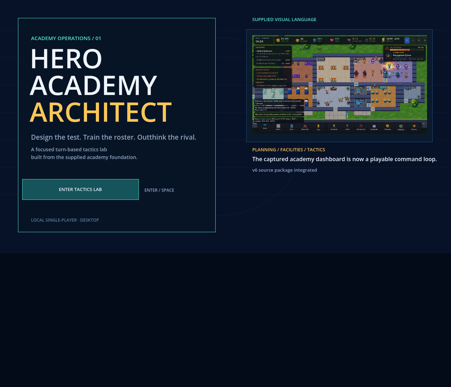

# Hero Academy Architect

A compact 2D academy-planning and turn-based tactics lab built with Godot 4.7. Design a training arena, deploy hero cadets and defensive modules, then direct a tactical test against an AI rival to earn accreditation.

> **Demo:** [open the live preview](https://3000-iqj49k3694noxypb44r3o-c5ab9a93.us3.manus.computer/)
>
> The repository also contains a self-hostable Web export in [`docs/demo/`](docs/demo/). Open `docs/demo/index.html` from a static host, or follow the [demo guide](docs/DEMO.md).



## What is included

- **Academy Planning:** place Vanguard cadets, Flux Mages, and Aegis Beacons on a readable 7×5 campus grid.
- **Tactical Test:** spend action points to move, target rivals within pulse range, manage cooldowns, and survive the rival response.
- **Accreditation:** receive a score and accreditation result, then replay the drill or revise the academy plan.
- **Supplied visual foundation:** the downloaded source package is retained as [`source-package.zip`](source-package.zip), while the integrated academy captures live in [`assets/supplied/`](assets/supplied/).

## Play

1. Press **Enter** or click **Enter Tactics Lab**.
2. Choose a planning role with keys **1–3** and click an open arena cell to deploy it.
3. Press **Enter** or click **Begin Tactical Test**.
4. Select a cadet, move one adjacent cell, or use **Pulse Strike** against a rival in range.
5. Press **Tab** to end the turn and let the AI rival act.
6. Clear both rivals for accreditation, or return to the plan and try a different formation.

See the full [playtest guide](docs/PLAYTEST.md) for tactical rules and the [architecture notes](docs/ARCHITECTURE.md) for implementation details.

## Run locally

The project is a Godot 4.7 Web-compatible project. From the repository root:

```bash
npm install
npm run check
npm run dev
```

Then open the preview server reported by the project tooling. To create the standalone Web export:

```bash
npm run build
```

The export is written to `dist/standalone/` locally and is mirrored in `docs/demo/` for static hosting.

## GitHub Pages

The committed `docs/demo/` folder is a complete static Godot Web export. To publish it with GitHub Pages, set the repository’s Pages source to the `main` branch and the `/docs` folder. The playable page will be:

```text
https://<account>.github.io/<repository>/demo/
```

If the repository is private, GitHub Pages availability depends on the account plan and repository settings.

## Project map

| Path | Purpose |
| --- | --- |
| [`scripts/academy_main.gd`](scripts/academy_main.gd) | Title, planning, tactical simulation, AI turn, scoring, and results flow |
| [`scenes/main.tscn`](scenes/main.tscn) | Minimal Godot entry scene |
| [`web/loading.html`](web/loading.html) | Academy-themed Web loading shell with retry handling |
| [`assets/supplied/`](assets/supplied/) | Supplied academy reference captures integrated into the remix |
| [`docs/`](docs/) | Demo, playtest, architecture, and visual review documentation |

## Validation

The delivered checkpoint was validated with:

```text
npm run check
npm run build
npm run check -- --pack
```

The source and prepared-pack checks pass, and the live preview was stepped through from title to planning to tactical test.
