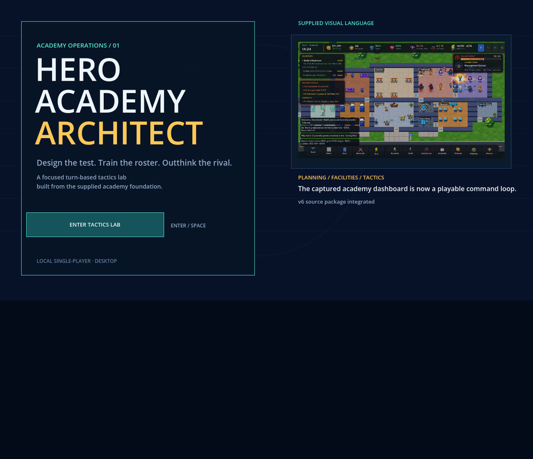
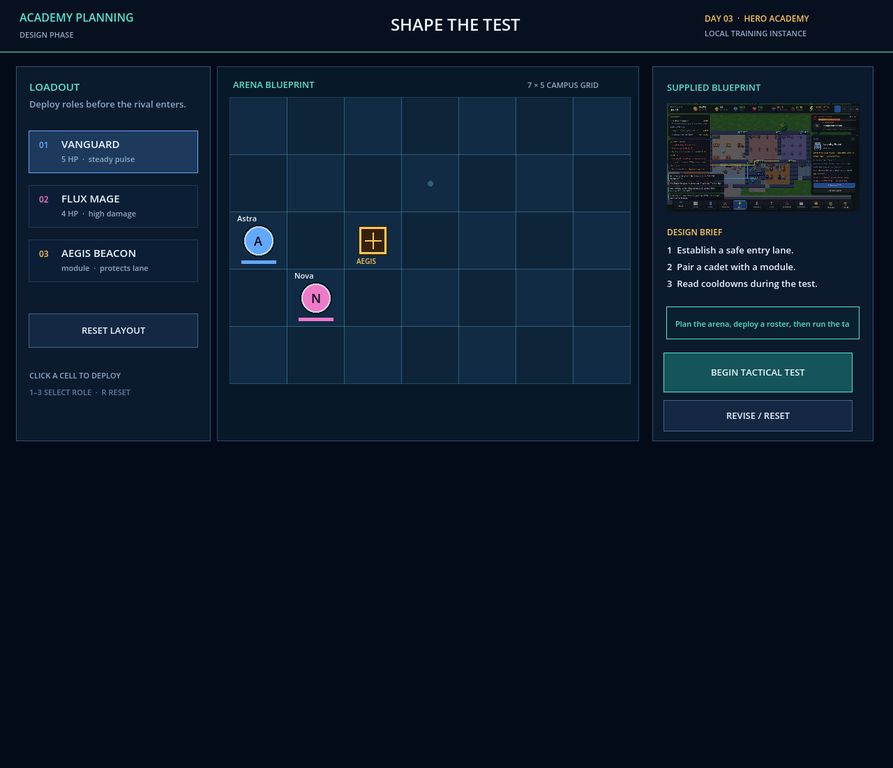
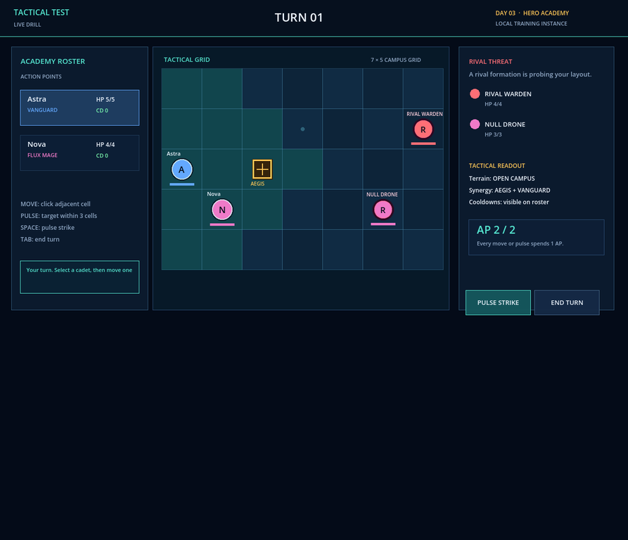

# Demo

## Playable Web build

The repository includes a Godot Web export in this directory. Serve the repository root with any static HTTP server and open `/docs/demo/`:

```bash
python3 -m http.server 8080
# open http://localhost:8080/docs/demo/
```

A static server is recommended because browsers may block WebAssembly and `.pck` loading from `file://` URLs.

For the current hosted preview, use the session demo link from the main README. Preview URLs can expire when the development session ends; the committed export is the durable demo artifact.

## Screenshots

### Title



### Planning



### Tactical test


